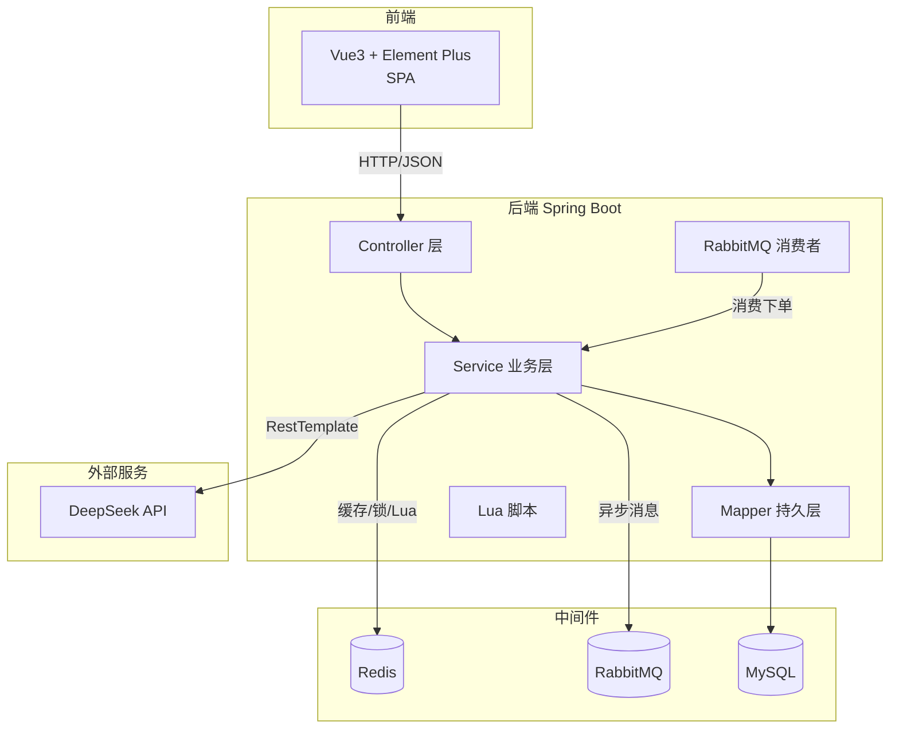

# 校园二手交易平台 概要设计说明书

## 1. 引言

### 1.1 编写目的
在需求规格说明书的基础上，确定系统的总体架构、技术选型、模块划分与关键技术方案，作为详细设计与编码的依据。

### 1.2 设计原则
- **前后端分离**：后端提供 RESTful API，前端独立部署。
- **分层架构**：controller（接口）→ service（业务）→ mapper（持久化）。
- **缓存优先**：热点数据走 Redis，减少数据库压力。
- **异步削峰**：抢购下单走消息队列，缓解瞬时并发。

---

## 2. 总体架构

---

## 3. 技术选型

| 层 | 技术 | 选型理由 |
|---|---|---|
| 前端 | Vue3 + Element Plus + Vue Router + Pinia + Axios | 组件化、生态成熟 |
| 后端 | Java 17 + Spring Boot 3.2 | 主流、稳定、课程契合 |
| ORM | MyBatis-Plus 3.5 | 简化 CRUD，逻辑删除、分页插件 |
| 缓存 | Redis 5+ | 缓存/锁/Geo/BitMap/HLL/Lua 全覆盖 |
| 消息队列 | RabbitMQ 3.13 | 异步下单削峰 |
| 数据库 | MySQL 8.0 | 关系数据持久化 |
| AI | DeepSeek（chat-completions） | 团队已有 Key，中文能力强 |

---

## 4. 模块划分

| 模块 | 职责 | 主要类 |
|---|---|---|
| 用户 | 验证码、登录、自动注册 | UserController / UserService |
| 商品 | 列表、详情缓存、发布、附近、UV | GoodsController / GoodsService |
| 订单 | 普通下单、秒杀、状态流转 | OrderController / OrderService |
| 消息 | 秒杀异步下单消费 | SeckillMessageListener |
| 社交 | 关注、粉丝、共同关注、Feed | FollowController / FollowService |
| 签到 | 签到、连续天数 | SignController / SignService |
| AI Agent | 智能推荐、议价咨询 | AgentController / AgentService |
| 公共 | 拦截器、分布式锁、常量、统一响应 | LoginInterceptor / SimpleRedisLock / RedisConstants / Result |

---

## 5. 关键技术方案

### 5.1 缓存三大问题（商品详情）
- **穿透**：查询不存在的 id，写入空值 `"NULL"` 缓存，TTL 2 分钟。
- **击穿**：缓存过期瞬间高并发打到 DB，用 `setnx` 互斥锁，只允许一个线程重建缓存，其余重试。
- **雪崩**：缓存 TTL 加随机值（`TTL + random(10)`），避免同一时刻大量过期。

### 5.2 秒杀并发安全
- 库存预加载到 Redis。
- Lua 脚本**原子**完成：查库存 → 判断是否重复下单 → 扣库存。
- 成功后发 RabbitMQ 消息 `goodsId:userId`，消费者异步创建订单 + 扣数据库库存，削峰。

### 5.3 Feed 流（推模式）
- 用户发布商品后，取出其粉丝集合，将商品 id 写入每个粉丝的 ZSet（score=时间戳）。
- 粉丝拉取时按 ZSet 倒序取最近 20 条，再回查商品。

### 5.4 附近商品（GeoHash）
- 发布商品时 `GEOADD geo:goods 经度 纬度 商品id`。
- 查询时 `GEORADIUS` 按半径返回商品 id，再回查 MySQL。

### 5.5 分布式锁
- `setnx lock:key UUID`（带过期时间）获取锁，释放时用 Lua 校验 value 一致才删除，防误删。

### 5.6 AI Agent
- 独立 Service 模块，REST 暴露；拼接带约束的 prompt（"基于数据、不确定就说不确定、不要编造"）；失败降级返回提示。

---

## 6. 安全设计

- 登录 token 存 Redis，30 分钟过期；请求头 `authorization` 携带 token，拦截器统一校验。
- 越权校验：更新/删除商品、更新订单时校验是否为卖家/买家本人。
- 敏感信息（MySQL 密码、DeepSeek Key）通过 `application-local.yml` 本地配置，`.gitignore` 忽略不入库。
