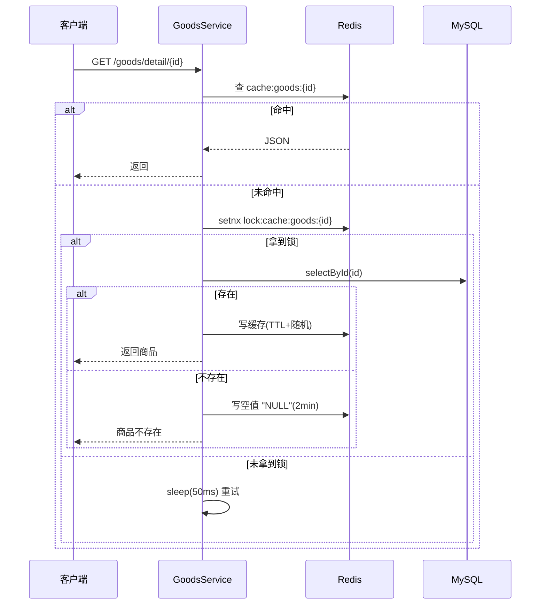
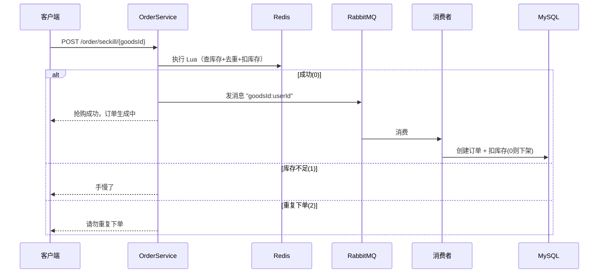
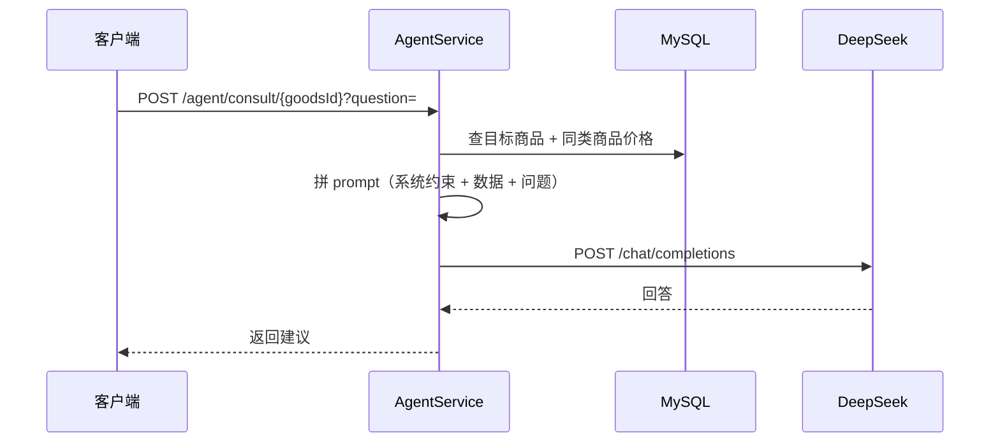

# 校园二手交易平台 详细设计说明书

## 1. 引言
在概要设计基础上，细化接口定义、关键流程时序与核心类设计，指导编码与测试。

---

## 2. REST API 设计

> 统一响应结构：`{ success, errorMsg, data, total }`。
> 除标注「公开」外，均需在请求头带 `authorization: <token>`。

### 2.1 用户
| 方法 | 路径 | 说明 | 公开 |
|---|---|---|---|
| POST | `/user/code?studentNo=` | 发送验证码 | ✅ |
| POST | `/user/login` | 登录（body：studentNo, code）| ✅ |
| GET | `/user/me` | 当前用户 | — |

### 2.2 商品
| 方法 | 路径 | 说明 | 公开 |
|---|---|---|---|
| GET | `/goods/list` | 列表/搜索（page,size,category,keyword,sort）| ✅ |
| GET | `/goods/detail/{id}` | 商品详情 | ✅ |
| GET | `/goods/hot` | 热门抢购商品 | ✅ |
| GET | `/goods/nearby` | 附近（longitude,latitude,radius）| ✅ |
| POST | `/goods/publish` | 发布商品 | — |
| PUT | `/goods` | 更新商品 | — |
| DELETE | `/goods/{id}` | 下架/删除 | — |
| GET | `/goods/uv/{id}` | 商品 UV | — |

### 2.3 订单
| 方法 | 路径 | 说明 |
|---|---|---|
| POST | `/order/{goodsId}` | 普通下单 |
| POST | `/order/seckill/{goodsId}` | 抢购下单 |
| GET | `/order/my` | 我的订单 |
| PUT | `/order/{orderId}/{status}` | 更新状态 |

### 2.4 社交 / 签到 / Agent
| 方法 | 路径 | 说明 |
|---|---|---|
| PUT | `/follow/{followUserId}/{isFollow}` | 关注/取关 |
| GET | `/follow/isFollow/{followUserId}` | 是否关注 |
| GET | `/follow/common/{otherId}` | 共同关注 |
| GET | `/follow/feed` | Feed 流 |
| POST | `/sign` | 签到 |
| GET | `/sign/count` | 连续签到天数 |
| GET | `/agent/recommend` | 智能推荐 |
| POST | `/agent/consult/{goodsId}?question=` | 议价咨询 |

---

## 3. 关键流程时序

### 3.1 商品详情缓存（穿透/击穿/雪崩）



### 3.2 抢购（Lua + RabbitMQ 异步）



### 3.3 AI 议价咨询



---

## 4. 核心类设计

| 类 | 职责 | 关键方法 |
|---|---|---|
| `GoodsServiceImpl` | 商品业务 + 缓存三大问题 | detail()（锁重建）、nearby()（Geo）、publish()（Geo+Feed） |
| `OrderServiceImpl` | 下单/秒杀 | seckill()（Lua）、createOrderAsync()（@Transactional 消费） |
| `FollowServiceImpl` | 关注/Feed | follow()、feed()（ZSet 倒序） |
| `SignServiceImpl` | 签到 | sign()（setBit）、signCount()（BitField 低位连续计数） |
| `AgentServiceImpl` | AI | recommend()、consult()、callDeepSeek() |
| `LoginInterceptor` | 鉴权 | preHandle()（查 Redis token） |
| `SimpleRedisLock` | 分布式锁 | tryLock()（setnx）、unlock()（Lua 校验删除） |
| `SeckillMessageListener` | MQ 消费 | @RabbitListener 调 createOrderAsync |

---

## 5. 关键脚本

### 5.1 秒杀 Lua（`lua/seckill.lua`）
```
KEYS[1] = 库存 key；KEYS[2] = 下单标记 key；ARGV[1] = userId
返回：0 成功；1 库存不足；2 重复下单
```
逻辑：`GET 库存` 判断 > 0 → `SISMEMBER` 判断未下单 → `DECR` 扣库存 + `SADD` 记录用户。

### 5.2 分布式锁释放 Lua
校验当前 value 是否为锁持有者的 UUID，一致才 `DEL`，防止误删他人锁。

---

## 6. 异常处理与降级

- 统一异常由 `Result.fail(msg)` 返回业务错误码与提示。
- AI 调用失败捕获异常，返回"暂不可用"，不影响主流程。
- 消息消费失败由 RabbitMQ 重试机制兜底，订单创建带 `@Transactional` 保证一致性。
