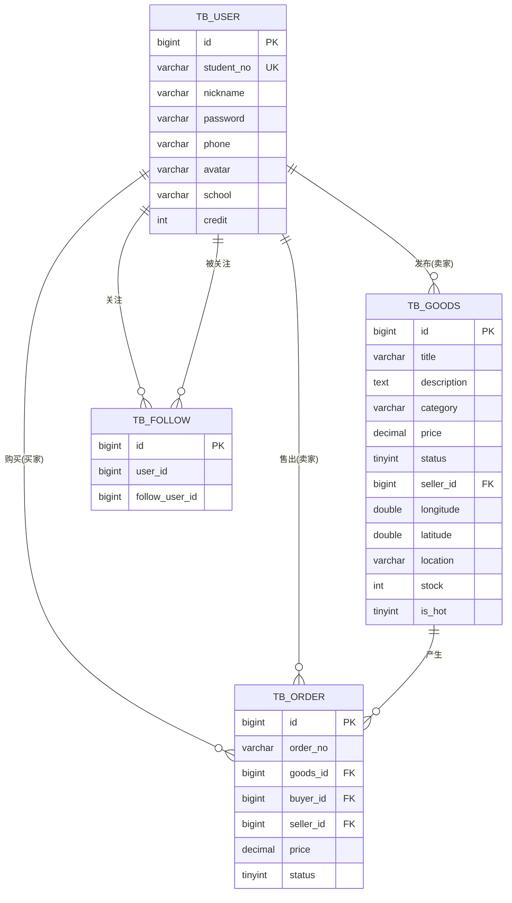

# 校园二手交易平台 数据库设计

## 1. 概述

- 数据库：MySQL 8.0，库名 `campus_secondhand`，字符集 `utf8mb4`。
- 持久化数据用 MySQL（用户/商品/订单/关注），高性能与临时数据用 Redis（缓存/库存/Feed/签到/UV/Geo/分布式锁）。

---

## 2. 概念模型（ER 图）

---

## 3. 逻辑结构（表定义）

### 3.1 用户表 `tb_user`
| 字段 | 类型 | 说明 |
|---|---|---|
| id | BIGINT PK 自增 | 主键 |
| student_no | VARCHAR(20) 唯一 | 学号（登录账号） |
| nickname | VARCHAR(50) | 昵称 |
| password | VARCHAR(100) | 密码（预留，登录走验证码） |
| phone | VARCHAR(20) | 手机号 |
| avatar | VARCHAR(255) | 头像 |
| school | VARCHAR(100) | 学院 |
| credit | INT | 积分 |
| create_time / update_time | DATETIME | 创建/更新时间 |
| deleted | TINYINT | 逻辑删除（0 否 1 是） |

### 3.2 商品表 `tb_goods`
| 字段 | 类型 | 说明 |
|---|---|---|
| id | BIGINT PK 自增 | 主键 |
| title | VARCHAR(100) | 标题 |
| description | TEXT | 描述 |
| category | VARCHAR(50) | 分类（数码/书籍/生活用品/服饰/运动/其他） |
| price | DECIMAL(10,2) | 价格 |
| images | VARCHAR(1000) | 图片 URL 逗号分隔 |
| status | TINYINT | 1 在售 2 已售 3 下架 |
| seller_id | BIGINT | 卖家 id |
| longitude / latitude | DOUBLE | 经纬度（附近查询） |
| location | VARCHAR(100) | 位置描述 |
| condition_desc | VARCHAR(200) | 成色描述 |
| view_count | INT | 浏览量 |
| stock | INT | 库存（抢购用） |
| is_hot | TINYINT | 是否热门抢购 0 否 1 是 |
| create_time / update_time | DATETIME | 创建/更新时间 |
| deleted | TINYINT | 逻辑删除 |

### 3.3 订单表 `tb_order`
| 字段 | 类型 | 说明 |
|---|---|---|
| id | BIGINT PK 自增 | 主键 |
| order_no | VARCHAR(40) | 订单号 |
| goods_id | BIGINT | 商品 id |
| buyer_id | BIGINT | 买家 id |
| seller_id | BIGINT | 卖家 id |
| price | DECIMAL(10,2) | 成交价 |
| status | TINYINT | 1 已拍 2 面交中 3 已完成 4 已取消 |
| create_time / update_time | DATETIME | 创建/更新时间 |

### 3.4 关注表 `tb_follow`
| 字段 | 类型 | 说明 |
|---|---|---|
| id | BIGINT PK 自增 | 主键 |
| user_id | BIGINT | 关注者 id |
| follow_user_id | BIGINT | 被关注者 id |
| create_time | DATETIME | 创建时间 |

> 唯一索引 `uk_user_follow(user_id, follow_user_id)` 防重复关注。

---

## 4. 索引设计

| 表 | 索引 | 字段 | 用途 |
|---|---|---|---|
| tb_user | uk_student_no | student_no | 登录查询 |
| tb_goods | idx_seller | seller_id | 卖家商品 |
| tb_goods | idx_category | category | 分类筛选 |
| tb_order | idx_buyer | buyer_id | 买家订单 |
| tb_order | idx_seller | seller_id | 卖家订单 |
| tb_follow | uk_user_follow | user_id, follow_user_id | 关注去重 |

---

## 5. Redis 数据结构设计

| 业务 | Key 前缀 | 类型 | 说明 |
|---|---|---|---|
| 验证码 | `login:code:` | String | 学号 → 验证码，TTL 2 分钟 |
| 登录 token | `login:token:` | Hash | token → 用户信息，TTL 30 分钟 |
| 商品缓存 | `cache:goods:` | String(JSON) | 商品详情，TTL 30 分钟（空值 `"NULL"` 缓存 2 分钟） |
| 秒杀库存 | `seckill:stock:` | String | 抢购库存，Lua 原子扣减 |
| 秒杀下单标记 | `seckill:order:` | Set | 已下单用户去重 |
| 关注集合 | `follow:` | Set | 用户关注的人 |
| 粉丝集合 | `fans:` | Set | 用户的粉丝 |
| Feed 收件箱 | `feed:` | ZSet | 粉丝收到的商品 id，score 为时间戳 |
| 签到 | `sign:` | BitMap | 用户按月签到位图 |
| 商品 UV | `uv:goods:` | HyperLogLog | 商品独立访客量 |
| 附近商品 | `geo:goods` | Geo | 商品经纬度索引 |
| 分布式锁 | `lock:` | String | 缓存重建互斥锁（setnx + UUID） |

---

## 6. 测试数据说明

`sql/init.sql` 末尾插入：
- 1 个测试用户：学号 `20210001`。
- 4 条测试商品：高数教材、iPad 2021、通勤自行车（普通），机械键盘（`is_hot=1`，`stock=5`，用于抢购演示）。
